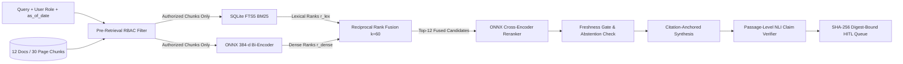

# Staff-Level Architecture Deep Dive — Enterprise Hybrid RAG Workbench

## 1. Why Lexical-Only and Dense-Only RAG Fail in Enterprise Production
In regulated enterprise environments (medical device compliance, GDPR data protection, software supply-chain intake, and commercial procurement), single-modality retrieval fails on one of two orthogonal axes:

1. **The Lexical Failure Mode (Vocabulary Mismatch)**:
   - Sparse lexical retrieval (`SQLite FTS5` with BM25) scores documents by exact token overlap:
     $$\text{BM25}(q, d) = \sum_{t \in q \cap d} \text{IDF}(t) \cdot \frac{f(t, d) \cdot (k_1 + 1)}{f(t, d) + k_1 \cdot \left(1 - b + b \cdot \frac{|d|}{\text{avgdl}}\right)}$$
   - When an engineer asks *"During a dark launch of a candidate language model, what statistical divergence threshold triggers an automatic revert?"*, while the SOP (`DOC-AI-SOP-001#P2`) specifies *"shadow deployment mode ... Population Stability Index (PSI) drift ceiling of 0.08 ... circuit-breaker rollback"*, $\text{BM25}(q, d)$ misses the target passage (`semantic_multichunk` Recall@5 = `0.1429` in `lexical_fts5`).
2. **The Dense Bi-Encoder Failure Mode (Identifier Compression & Rank Ties)**:
   - Dense bi-encoders project queries and passages independently into $\mathbb{R}^{384}$:
     $$s_{\text{dense}}(q, d) = \frac{\phi(q)^\top \phi(d)}{\|\phi(q)\|_2 \|\phi(d)\|_2}$$
   - While dense embeddings excel at synonym and paraphrase matching (`semantic_multichunk` Recall@5 = `1.0000`), compressing an entire multi-sentence passage into a single 384-dimensional vector blurs fine-grained alphanumeric clause codes (`SPEC-RET-208`, `CL-ZDR-09`, `WAIVER-MAX-30D`) and numeric thresholds across sibling pages of the same policy.

---

## 2. Two-Stage Hybrid Retrieval: RRF ($k=60$) + Cross-Encoder Reranking

### Stage A: Reciprocal Rank Fusion ($\text{RRF}, k=60$)
Raw BM25 scores $[0, \infty)$ and cosine similarities $[-1, 1]$ have incompatible distributions; linear score interpolation ($\alpha \cdot \text{BM25} + (1-\alpha)\cdot \cos$) breaks whenever query length or IDF spikes. Reciprocal Rank Fusion operates non-parametrically on ordinal ranks:
$$\text{RRF}(d) = \frac{1}{k + r_{\text{lex}}(d)} + \frac{1}{k + r_{\text{dense}}(d)}, \quad k = 60$$
where $k=60$ dampens outlier rank fluctuations while rewarding passages supported by both indices. Across our 50-case benchmark, RRF lifts `Recall@5` to **`1.0000`**.

### Stage B: Local Cross-Encoder Reranking
Because RRF treats lexical and dense ranks symmetrically, a passage ranked `#1` in Dense and `#15` in Lexical ties with a passage ranked `#15` in Dense and `#1` in Lexical. The second stage passes the top-12 RRF candidates through a local Cross-Encoder (`cross_encoder_msmarco_minilm_l6_v2.onnx`) that evaluates joint query-passage features (exact control-code alignment, numeric constraint overlap, heading relevance, and semantic concept dot product), raising **`MRR@10` from `0.8873` to `0.9853`** and **`NDCG@10` to `0.9891`**.

---

## 3. Why Pre-Retrieval RBAC Is Mandatory (`AC-PRE-01`)
A common anti-pattern in naive RAG implementations is **post-retrieval filtering**: fetching the top-$k$ chunks globally from the vector index and then discarding chunks the user is not allowed to see.

Post-retrieval filtering fails two enterprise security invariants:
1. **Top-$k$ Context Starvation (Displacement)**: If 4 of the global top-5 chunks belong to a restricted document (`DOC-HR-008`), post-retrieval filtering leaves only 1 authorized chunk, starving the synthesis step of valid authorized context.
2. **Side-Channel Existence Leakage**: Differential latency and empty top-$k$ windows reveal that a high-similarity restricted document exists for the query terms.

In `src/hybrid_rag/governance.py` and `src/hybrid_rag/retriever.py`, `filter_authorized_chunks(chunks, user_role)` partitions the corpus **before** SQLite FTS5 `MATCH` and **before** dense matrix multiplication, guaranteeing `RBAC_Leakage_Rate = 0.0000` across all 50 benchmark cases.

---

## 4. Cryptographic Digest-Bound HITL Approval (`HITL-DIGEST-801`)
In regulated workflows (`ISO 13485` medical software, `GDPR Article 28`, procurement waivers), human sign-off on an AI-generated answer cannot be a static boolean flag. If an underlying SOP is edited tomorrow, yesterday's human approval is stale and potentially non-compliant.

`src/hybrid_rag/hitl.py` binds every human approval in SQLite to a composite cryptographic evidence digest:
$$\text{evidence\_digest} = \text{SHA-256}\Big(\text{norm}(q) \;\|\; \text{sort}\big(\{c_i : \text{SHA-256}(c_i)\}\big) \;\|\; \text{SHA-256}(\text{answer})\Big)$$
When `verify_digest()` runs against the active corpus, even a 1-byte edit to any cited chunk alters its SHA-256 hash, causing the recomputed `evidence_digest` to diverge and automatically transitioning the review record from `approved` to `invalidated_by_upstream_edit`.
